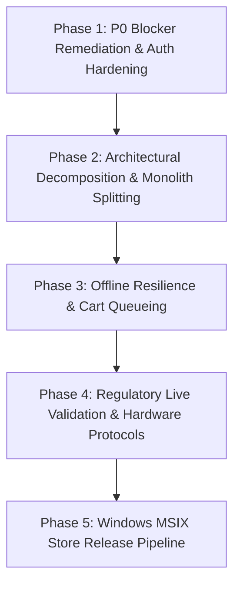

# DaxabitHMS — Production Implementation & Hardening Plan

**Document Date:** October 2026  
**Guiding Architecture Rules:**
- Zero rewrite from scratch; preserve all existing working functionality.
- Server-authoritative calculations; zero client-side pricing or tax trust.
- Non-destructive database migrations only.
- Every important change must have automated unit/integration tests.
- Work in small, reviewable, testable phases.

---

## 1. Phased Implementation Roadmap



---

## Phase 1: Critical P0 Blockers & Auth Hardening

### 1.1 Objective
Resolve dead ends and security gaps in the authentication stack without modifying core database schemas or existing user sessions.

### 1.2 Target Deliverables
1. **PIN Management Flow:**
   - **Backend:** Add `PUT /api/v1/users/:id/pin` endpoint guarded by `@Auth('users.manage')` or self-service password confirmation.
   - **Validation:** PIN must be 4 to 8 digits, numeric only, hashed with bcrypt (cost factor 12) into `user.pinHash`.
   - **Audit:** Emit `user.pin_updated` audit log.
   - **Frontend:** Add "Set Quick Login PIN" button in **Settings → Staff → Edit Staff** dialog.
   - **Automated Tests:** Add unit tests in `auth.service.spec.ts` testing PIN setting, complexity validation, and successful PIN authentication.

2. **Session Revocation Guard:**
   - Implement optional token invalidation by incrementing a `tokenVersion` on `User` upon explicit logout, instantly revoking leaked bearer tokens.

### 1.3 Risk Assessment & Mitigation
- **Risk:** Existing staff logins disrupted.
- **Mitigation:** Existing email/password and TOTP flows remain untouched; PIN is purely an opt-in fast-login method for till terminals.

---

## Phase 2: Architectural Decomposition (Orders Service)

### 2.1 Objective
Decompose the monolithic 2,540-line `orders.service.ts` into focused sub-services within the `orders` module while strictly preserving the existing public interface and controller endpoints.

### 2.2 Decomposition Architecture
```
apps/backend/src/modules/orders/
├── orders.service.ts              # Facade maintaining public API signatures
├── services/
│   ├── order-creation.service.ts  # Validation, table locking, cart conversion
│   ├── order-settlement.service.ts# Pricing, multi-tender payment, change, discounts
│   ├── order-kot.service.ts       # KOT ticket routing and kitchen station grouping
│   ├── order-refund.service.ts    # Row-locked refund calculation and inventory return
│   └── order-query.service.ts     # Filtered order listing, history, table tabs
```

### 2.3 Verification Strategy
- Run `pnpm --filter @daxabithms/backend test` after each extracted sub-service.
- Ensure all 28 existing test suites in `apps/backend/src/modules/orders/*.spec.ts` pass with 100% parity.

---

## Phase 3: Offline Resilience & Network Fault Tolerance

### 3.1 Objective
Prevent order loss and UI freezing during intermittent local Wi-Fi drops on POS tablets and waitstaff handhelds.

### 3.2 Target Deliverables
1. **Client-Side Optimistic Order Queue:**
   - Store pending order mutations in browser `IndexedDB` with an idempotency UUID (`clientRequestId`).
   - If `api.post('/orders')` fails with a network error or timeout, retain the draft in IndexedDB and flag the UI as "Syncing with till…".
   - Automatically retry when network connectivity restores (`window.addEventListener('online')`).

2. **WebSocket Reconnect & State Re-sync:**
   - Ensure the KDS ticket board automatically issues a full refetch (`queryClient.invalidateQueries({ queryKey: ['kds-tickets'] })`) upon Socket.IO reconnection to catch any tickets emitted during the disconnect window.

---

## Phase 4: Regulatory Certification & Live Gateways

### 4.1 Objective
Prepare Spain VERI\*FACTU and India GST billing for statutory certification and enterprise deployments.

### 4.2 Target Deliverables
1. **Spain VERI\*FACTU Pre-Production Run:**
   - Create a staging validation harness script using a certified Spanish test certificate (`.p12`).
   - Run end-to-end invoice submission against AEAT's test portal (`https://prewww1.aeat.es/...`).
   - Verify `CSV` generation and record acceptance codes.
   - Draft the legal *Declaración Responsable* documentation template according to Orden HAC/1177/2024.

2. **India GST Invoicing:**
   - Validate GST invoice numbers conform to the 16-character alphanumeric limit required by Indian tax rules.
   - Verify HSN/SAC code display on printouts and tax liability exports.

---

## Phase 5: Windows MSIX Store Release Pipeline

### 5.1 Objective
Transition Windows desktop packaging from developer testing to Microsoft Store production distribution.

### 5.2 Target Deliverables
1. **Partner Center Identity Configuration:**
   - Reserve the official application name in Microsoft Partner Center.
   - Replace placeholder GUIDs in `windows/msix/AppxManifest.xml` with the real `Identity/Name` and `Publisher` CN.
2. **Windows App Certification Kit (WACK):**
   - Execute WACK validation on a physical Windows 10/11 machine.
   - Verify zero restricted capability violations and clean install/uninstall cycles.
3. **Automated MSIX CI Release Workflow:**
   - Create `.github/workflows/release-windows.yml` to build, sign, and upload the production `.msix` artifact on tagged releases.

---

## 3. Rollback & Disaster Recovery Procedures

1. **Database Schema Migrations:**
   - Never run destructive migrations (no `DROP TABLE`, `DROP COLUMN`, or `TRUNCATE`).
   - All migrations must be backwards-compatible (additive nullable columns or columns with defaults).
   - In the event of a deployment failure, roll back the application container; existing database columns will remain harmlessly unused.

2. **Application Revert Procedure:**
   - Container deployments: Repin `image:` in `docker-compose.yml` to the previous stable release tag and run `docker compose up -d`.
   - Windows desktop: Re-install the previous validated MSIX package; local database files in `%LOCALAPPDATA%\DaxabitHMS` remain intact.
